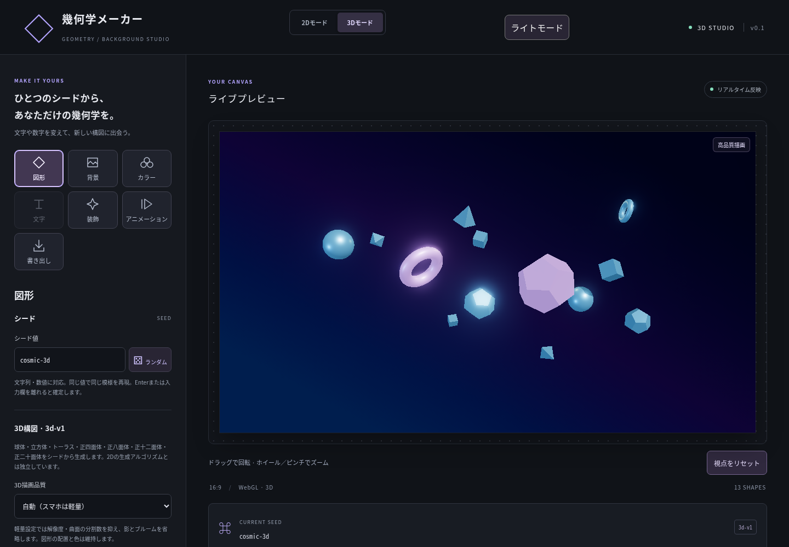
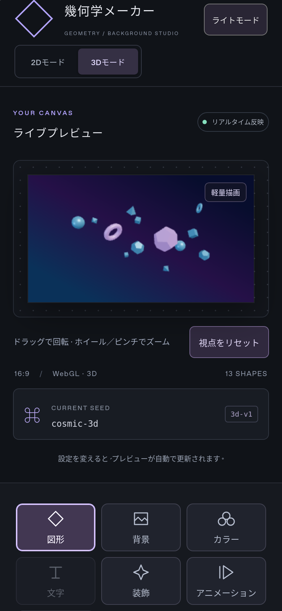

# 3Dモード（3d-v1）

## 起動と操作

```sh
npm ci
npm run dev
```

ページは従来どおり2Dモードで開きます。ヘッダーの「3Dモード」を押したときだけ、Three.js / React Three Fiberと3D描画処理を読み込みます。WebGL 2が必要です。

- **図形**：シード、ランダムシード、再生成、密度、縦横比、描画品質。
- **背景・カラー**：既存の単色・グラデーション、シード配色、個別編集・固定、画像配色抽出、ビジュアルテーマを共用。
- **装飾**：既存の発光0〜200%に加え、テーマ連動・マット・メタル・ガラス・ワイヤーフレームの切り替え、表面の粗さ・金属感・ライトの強さ。
- **アニメーション**：3D専用の回転・浮遊、速度、一時停止・再開。
- **視点操作**：ドラッグで回転。ホイールまたは2本指のピンチでズーム。「視点をリセット」で正面に戻る。キャンバスにフォーカスし、Shift＋矢印キーでも回転可能。
- **書き出し**：「3D PNGを書き出す」。現在の視点・姿勢・背景・発光を保存。プリセットまたはカスタム解像度を指定でき、比率が異なる場合は余白を追加。ファイル名に`3d-v1`・シード・解像度を含む。

3Dモードの「文字」は無効表示です。2Dへ戻ると文字設定と2D設定を引き続き使えます。2Dの成長・待機画面再生は3D表示中は一時停止し、戻る際に再開します。

## 再現性と互換性

`model.ts` は既存のシード付き乱数関数を利用する独立した3D構図生成器です。2Dの`scene.ts`、`scene-v5.ts`、密度・成長・待機画面・書き出しエンジンは変更していません。

- 同じシード・比率・3Dアルゴリズム版で同じ図形候補、位置、回転、サイズを生成。
- 球体、立方体、トーラス、正四面体、正八面体、正十二面体、正二十面体に対応。
- 密度は固定候補の表示を切り替える方式。0%は背景のみ。色・テーマ・マテリアル・描画品質は位置を変えない。
- 3Dの回転・浮遊は図形の固定パラメーターと経過時間から計算。フレームごとの乱数は使用しない。
- シード配色と個別カラー固定は既存の処理を共用し、指定色を書き換えずマテリアルの色に適用。
- 2DのSVG・PNG・MP4・WebM・設定JSONと文字編集・登場アニメーションは2Dモードで従来どおり利用可能。

## 負荷と制限

- 「自動」は画面幅720px以下またはタッチ主体の端末で軽量描画。軽量ではDPR 1、曲面の分割数削減、影・ブルームなし。自己発光は維持。
- 高品質はDPR最大1.75、影・ブルームあり。発光を0%にするとブルームを使わない。
- 通常の3D再生は`requestAnimationFrame`を使い、停止中は必要時のみ描画。非表示タブでは休止し、復帰時の時間ジャンプを防止。
- 視覚効果軽減設定がONの場合、初期の3D回転・浮遊は停止。利用者が明示的に再生できる。
- オブジェクト数は最大40。切り替えで3Dキャンバスを破棄し、テクスチャ・ポストエフェクト・コントロールのリソースも解放。
- PNGは256〜4096px、最大16,777,216画素。軽量描画では合計4,194,304画素まで。GPUの上限によってはさらに制限され、エラーを表示する。
- ガラスの透過・影・ブルームは端末のGPUと品質設定によって見え方が異なる。異なるGPU間での画素単位の一致は保証しない。
- この段階の3D出力はPNGのみ。3DのSVG・動画・設定JSON、3Dへの文字合成、3D成長アニメーションは対象外。2Dの設定JSONに3D設定を混在させていない。

## 検証

```sh
npm run typecheck
npm test
npm run build
npx playwright install chromium
npx playwright test tests/three.spec.ts
```

ユニットテストは全比率の配置、交差回避、シード再現性、密度の部分集合、時刻指定の姿勢、品質・テーマ・PNG上限を検証。ブラウザテストは遅延読み込み、2Dへ戻る際の状態保持、3D PNG、視点回転・ズーム、マテリアル・発光・背景、再生・一時停止、スマホ相当のタッチ操作、WebGL非対応時の案内を検証します。

### 実施結果（2026-11-10）

- 型チェック、本番ビルド：成功。
- ユニットテスト：26ファイル・209件成功（既存203件＋3D関連6件）。
- Chromiumの3Dブラウザテスト：9件成功。WebGL非対応、コンテキスト喪失、ライブラリ読み込み失敗時の復帰、2D成長・待機画面の休止と再開も確認。
- 既存2Dのブラウザテスト：10件成功（PNG/SVG/JSON、文字の直接編集・リサイズ・タッチ操作・登場アニメーション、文字入り動画）。
- デスクトップ：1920×1080の3D PNG保存成功。
- WebKitのスマホ相当環境（390×844、タッチ有効）：3D表示、自動軽量設定、発光スライダーのタップ変更、512×512 PNG保存、横はみ出しなしを確認。
- Chromiumのスマホ相当環境：1本指回転、2本指ピンチ、スライダー、PNG保存を確認。
- 本番ビルドのブラウザ確認：初期2D表示では3Dチャンクの通信0件、3D切替後のみ読み込み。ライトUI切替と2Dへの復帰でもページエラーなし。
- 実機iPhone/Androidでの確認と長時間GPU負荷試験は未実施。WebKit検証はLinux上のPlaywrightであり、実機Safariそのものではない。

同じ`cosmic-3d`シードとコズミック配色による確認画像：



