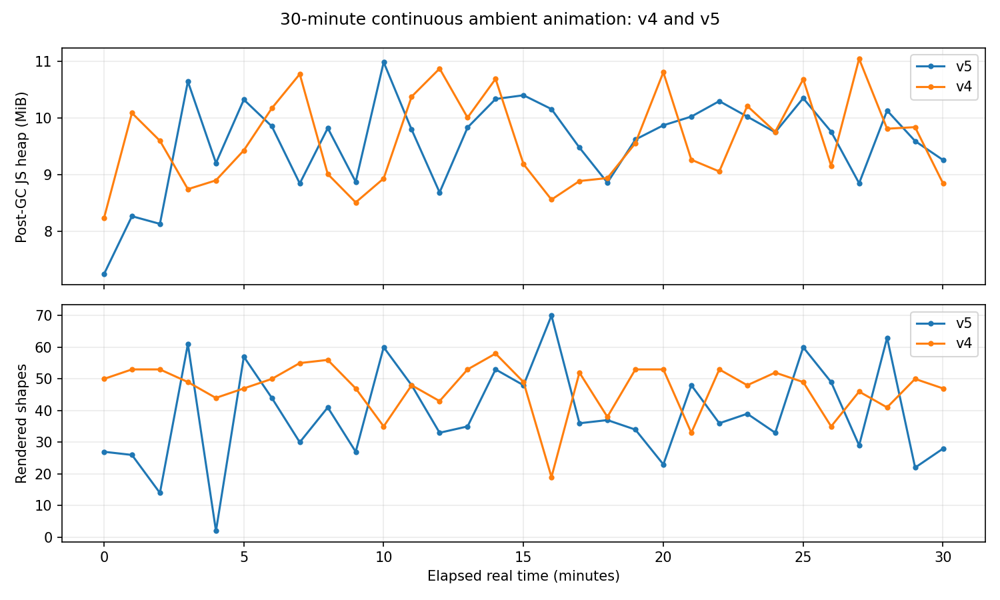
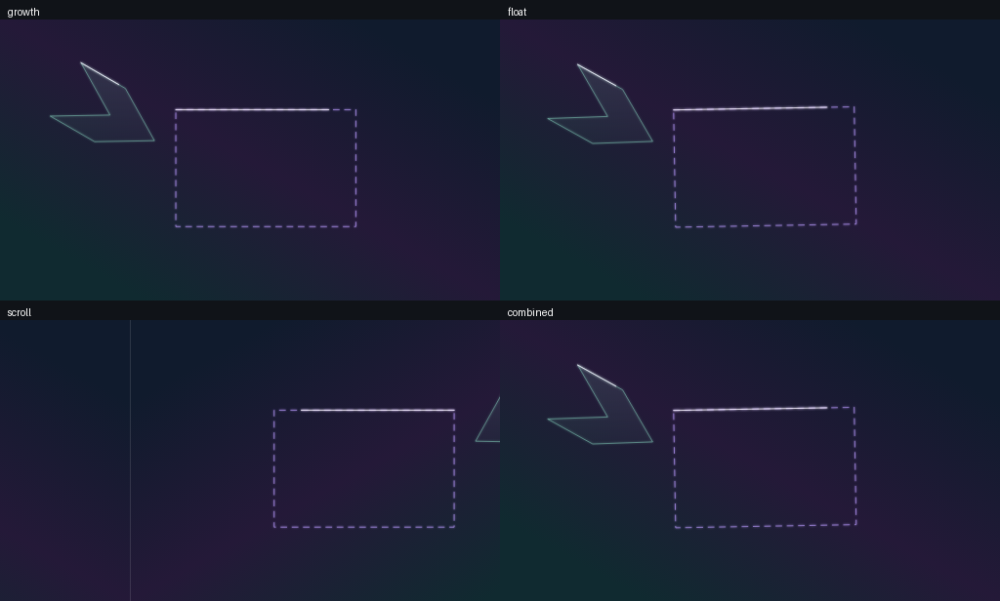

# 第5段階：2D自動待機画面

通常の生成設定に「自動待機画面モード」を追加しています。初期状態ではOFFです。ONにすると開始し、視覚効果軽減が有効な場合は再生ボタンで明示的に開始します。

## 操作

- 自動成長・再生成、浮遊・回転、無限スクロール、複合モードを選択できます。
- 再生／一時停止／停止を専用の時計で管理します。停止は時刻0へ戻します。OFFにすると元のシードの通常プレビューへ戻ります。
- 全画面表示、操作非表示／再表示をプレビュー内のボタンから操作できます。ブラウザがFullscreen APIに対応しない場合は案内を表示します。
- 詳細設定に再生速度0.25〜4倍、ループ時間4〜120秒、完成保持時間、トランジション時間、切り替え演出、自動シード更新、更新間隔、浮遊量、回転量、スクロール方向・周期内の移動回数、低負荷表示を用意しています。
- 密度、色と固定、発光、線幅、アルゴリズム、成長時間、イージングは既存の設定を利用します。

## 完全ループと無限変化

完全ループは指定ループ時間／待機再生速度で一周します。シードを固定し、時刻0と周期末が同じ状態になります。浮遊は整数周期のsin/cosを使い、接続された親子図形を同じ変換で動かします。背景・中景・前景のルートごとに周期を変えます。

無限変化は設定した更新間隔／再生速度ごとに次の構図へ移ります。シードは元シードと更新回数から決定し、通常の入力欄は上書きしません。自動シードOFFでは同じ構図を繰り返します。表示中のシードはプレビュー内に表示します。固定色は引き継ぎ、未固定色は既存のシード配色を使います。

成長モードと複合モードは、成長→保持→消失→次の背景から成長を繰り返します。周期が短い場合は保持・トランジションを制限して成長を周期内へ収めます。周期に余りがある場合は、消失後の背景のみの時間に割り当てます。初期周期14秒は成長6秒＋保持5秒＋切替3秒です。クロスフェードを標準とし、フェード、縮小、逆成長を選択できます。浮遊／スクロールの無限変化も次の構図へクロスフェードします。

スクロールは反転した隣接タイルを並べ、画面端の位置が合うようにしています。完全ループの周期内では偶数タイル分移動します。新しい無限ワールドやチャンクを増やす方式ではありません。

## 保存・動画

JSONにはambient設定を保存します。旧JSONは待機OFFとして読み込みます。JSON読込後は意図しない連続再生を避けるため待機OFF・停止状態にしますが、モードや詳細値は保持します。

待機ON時の動画書き出しは待機モードの映像になります。完全ループは1周期、無限変化は詳細設定の「待機動画の書き出し時間」で1〜120秒を指定します。解像度・FPS・WebM/MP4は既存設定を使用します。静止PNG/SVGは従来どおり通常の元シードの完成画像です。

各動画フレームは指定時刻から既存PreviewをSVG描画し、WebCodecsへ順に渡します。完全ループでは周期末の重複フレームを入れず、フレーム数に合わせて周期を等分します。音声なし。フレームを全件配列に保持しません。対応PCでは「ファイルへ逐次保存」を選択でき、圧縮データも64KiBのチャンクでファイルへ順に書き込みます。キャンセル時は書込を中止し、完成時にファイルを確定します。HTTPSの通常タブから利用してください。逐次保存のMP4は通常のMP4形式を使い、メタデータを末尾へ書いて動画全体のメモリ保持を避けます。

File System Access API非対応環境、または逐次保存を選択しない場合の待機動画は30秒・64MBまでです。長い動画は対応PCのChrome/Edgeで逐次保存を使用してください。従来の通常成長動画の256MB上限と、既存の解像度上限は維持します。高解像度・長時間はPC推奨です。FPSに合わせて動画長を1フレーム未満調整する場合があります。

## 負荷対策

requestAnimationFrameの経過時間で再生し、非表示タブでは時計と描画を休止します。復帰時に非表示だった時間を加算しません。通常30fps、低負荷20fpsで更新します。スクロールは固定数のタイル、構図切り替えは現在と次の最大2構図を使い、履歴を増やしません。RAF・visibilityリスナーは停止／アンマウント時に解除します。

## 検証と制限

型チェック、ユニット、ビルド、実ブラウザで各モード／v4/v5／通常への復帰／スマホ幅を検証します。完全ループの時刻0と周期末を画素比較し、4モードのWebM/MP4を実生成して境界フレームを比較します。

仮想時刻30分の構図更新テストではSVG最大3個、GC後ヒープは約4〜5MBでした。

実時間30分の連続運転も、v4とv5でそれぞれ完了しました。複合モード、再生速度4倍、更新間隔4秒、低負荷20fps、密度50%、発光100%で検証しています。各テストは約1800秒間、1分ごとに開始時を含む計31回記録し、再生・シード更新の継続を確認しました。

| アルゴリズム | GC後JSヒープ範囲 | 最終値 | SVG数のサンプル最大 | ブラウザ例外 |
| --- | --- | --- | --- | --- |
| v4 | 8.23〜11.05MiB | 8.85MiB | 2 | 0件 |
| v5 | 7.24〜10.99MiB | 9.26MiB | 3 | 0件 |

検証範囲では保持ヒープの継続的な増加やDOMの増殖を検出しませんでした。すべての端末・GPUのメモリ安定性を保証するものではありません。実機iPhone Safariの全画面・エンコードは未検証です。

生データ： [v4](soak-v4.json) / [v5](soak-v5.json) / [集計](soak-summary.json)。再現コマンド：`CHROMIUM_PATH=/usr/bin/chromium SOAK_VERSION=2d-v4 node scripts/ambient-soak.mjs`（v5も同様）。

型チェック・ユニット127件・ビルド成功。既存回帰24件と新規待機画面の検証を実施。全モードのループ境界、4モード×WebM/MP4の実出力、UI経由の出力、逐次保存データ、非表示タブ、一時停止、JSON復元、スマホ幅、全画面表示を確認しました。逐次保存データの検証には書込先のテスト用代替実装を使用し、実エンコードしたファイルをFFprobeで確認しています。

