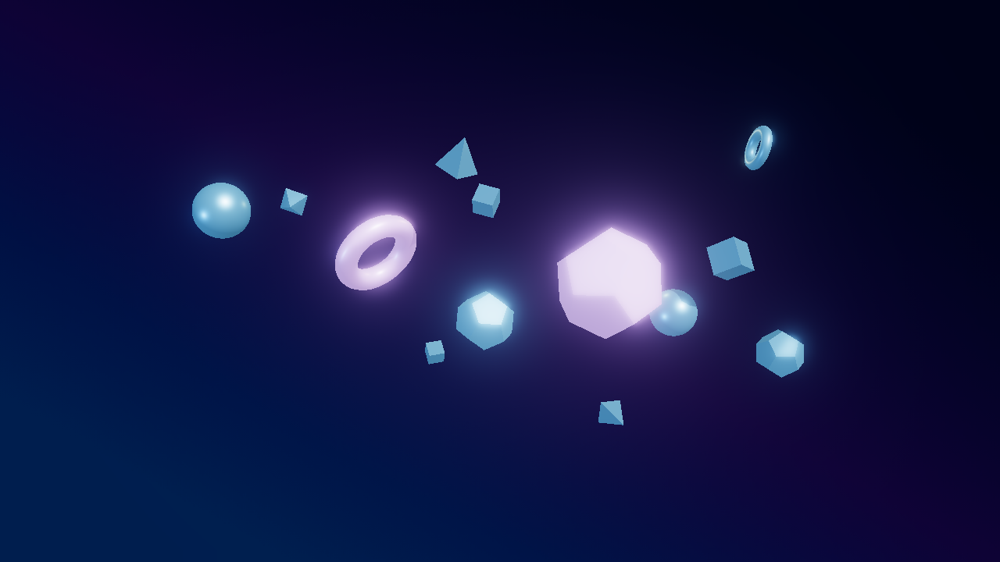
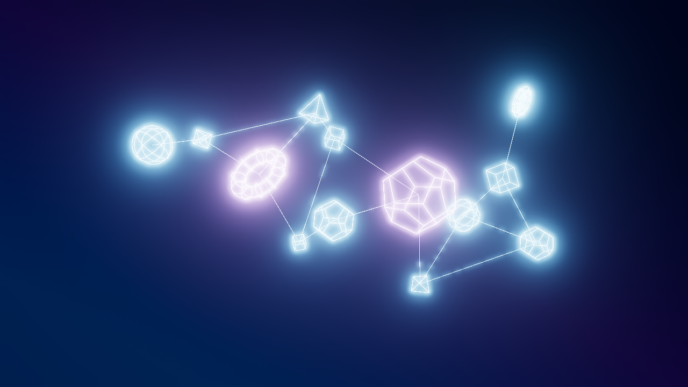
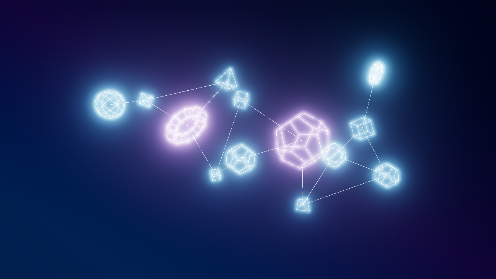
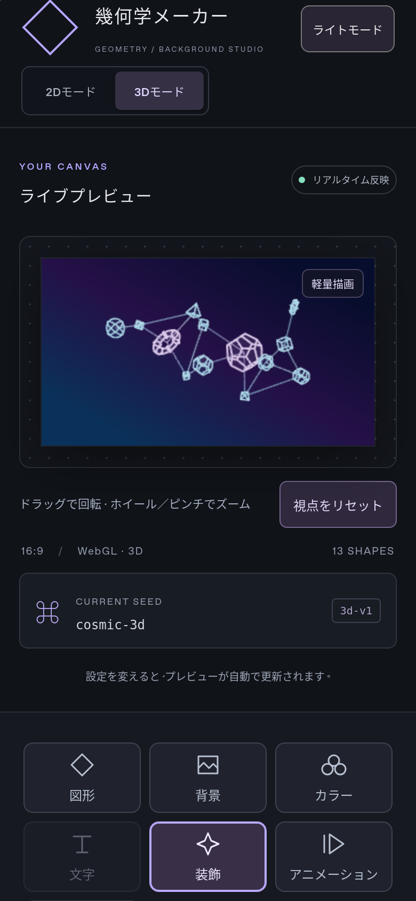

# 3D ネオンネットワーク

「3Dモード」→「装飾」→「ネオンネットワーク」で設定します。初期状態は従来の3D表示で、接続とネオン線画はOFFです。追加のライブラリや外部サービスは不要です。

## 使い方

| プリセット | 接続 | 輪郭 | 面 | パルス |
| --- | --- | --- | --- | --- |
| スタンダード | OFF | OFF | 通常のマテリアル | OFF |
| ネオンネットワーク | ON | 発光 | 半透明 | ON |
| サイバーグリッド | ON | 細めの発光線 | 非表示 | OFF |

プリセットは3Dスタイルだけを変更します。シード、配置、図形数、色、通常のマテリアル、カメラ視点、再生時刻は変更しません。

- **接続**：最大接続数1〜6、距離0.5〜15ワールド単位、太さ0.25〜6倍、不透明度0〜1、発光0〜200%、なし／パルスを指定できます。
- **線画**：「線のみ」「線＋半透明面」「面＋輪郭強調」。太さ0.25〜6倍、発光0〜200%、半透明面の不透明度0〜1を指定できます。
- **色**：自動（図形色）、主役色、補助色、アクセント色、カスタムHEX。通常の配色・テーマ・個別固定を参照し、元のカラー設定を変更しません。「背景とのコントラストを補正」をONにした場合だけ描画色を補正します。
- **パルス**：「アニメーション」の3D再生／一時停止と連動します。視覚効果軽減設定で3D再生が停止している場合、プリセット選択だけでは再生を始めません。
- **PNG**：「書き出し」→「3D PNGを書き出す」。現在のカメラ・姿勢・パルスの状態を含めて保存します。高解像度では線幅も比例して拡大します。
- **3D設定JSON**：「書き出し」の「3D設定JSONを保存／読込」。シード、比率、密度、背景、配色・固定、テーマ、通常3D設定、接続・輪郭設定、カメラ、再生時刻、出力解像度を保存します。停止状態で保存すれば、その姿勢とパルスの状態へ復元できます。

## 接続と描画の仕様

接続は初期構図のオブジェクト中心間距離で判定します。候補を距離→端点IDの順で安定ソートし、両端の最大接続数を守りながら近い順に採用します。重複、自分自身、非表示オブジェクトは接続対象にしません。浮遊中は接続関係を保持し、端点を同じ姿勢計算へ追従させます。距離制限は初期位置に対する制限であり、浮遊中の距離で接続を切り替える機能ではありません。

多面体の輪郭は22度の閾値で`EdgesGeometry`から抽出し、面内部の三角分割線を除きます。球体は大円・緯線、トーラスは主円と断面円による滑らかな輪郭を使用します。線画は`LineSegments2`で描画し、深度判定を維持します。半透明化の切り替えではマテリアルを更新し、不透明シェーダーが残る問題を防止しています。

高品質ではHDR線色と既存のBloomを組み合わせます。各線の発光が0%ならHDR増幅しません。線画の発光と通常図形の発光は独立して設定できます。

## 性能とモバイル

- 接続の再計算はシード・比率・密度・接続距離・最大接続数・ON/OFFの変更時だけ。毎フレームの再抽選はしません。
- 最大40オブジェクト、最大120接続。ネットワーク全体を1個の共有Geometry／Materialにまとめ、端点と頂点色のバッファを更新します。フレームごとにGPUリソースを新規作成しません。
- 輪郭Geometryは形状ごとに共有。不要になったGeometry／Materialは破棄します。
- 軽量画質では曲線の分割数とDPRを抑え、Bloomを使わず線色の明るさで発光の強弱を表現します。
- 軽量画質ではモバイルGPUの細線精度を考慮した画面座標の線幅を使用します。プレビューの高さを基準に書き出し時も拡大し、最低限の視認性を確保します。
- パルスは既存の3D時刻から計算するため、一時停止・非表示タブの休止を共用し、フレームごとの乱数は使用しません。

## 設定互換性

3D設定は`kind: geometry-maker-3d`、`schemaVersion: 1`、`algorithmVersion: 3d-v1`の専用JSONです。従来の2D設定スキーマは変更していません。2D設定は2Dモードで読み込めます。

接続・輪郭の項目がない旧3D設定オブジェクトには、両機能OFFの初期値を補完します。不正な数値、色、モード、カメラ、未対応の版、64KBを超えるファイルはエラーとして扱い、検証に成功するまで設定を適用しません。3D生成候補や2Dエンジンは変更していません。

## 検証コマンド

```sh
npm run typecheck
npm test
npm run build
npx playwright test tests/neon-network.spec.ts tests/three.spec.ts
npx playwright test tests/export.spec.ts tests/preview-text.spec.ts tests/preview-text-transform.spec.ts tests/text-entrance.spec.ts
```

ユニットテストでは接続の再現性、距離、両端の次数、IDの同距離判定、重複・自己接続、密度、輪郭、プリセット、JSON検証・旧設定・2D互換性を確認します。ブラウザでは画像の実ピクセルを比較し、3表示方式、色、太さ、不透明度、発光、パルス停止、PNG、JSONからの同一画像復元、モバイル操作、通常3Dと既存2Dの回帰を確認します。

### 実施結果（2026-11-10）

- TypeScript型チェック・本番ビルド：成功。
- Vitest：29ファイル、218件成功。
- Playwright／Chromium：ネオン5件＋通常3D9件、既存2D関連10件が成功。一時停止中に接続色・発光だけを変更しても、書き出し操作を挟まずライブ画面が更新されることを確認。
- パルスを停止して保存したPNGと、JSON読込で復元したPNGが同一になることを確認。
- 1920×1080のネオンPNGを書き出し、同じ構図の3プリセットを1280×720で保存。
- WebKitのスマホ相当環境：3D表示、軽量画質、スライダーのタップ、ネオンPNG保存、横はみ出しなし、ページエラーなしを確認。
- 本番ビルド：初期2Dでは3Dチャンクを読み込まず、3D切替後のネットワーク表示・PNG保存・2Dへの復帰を確認。

実機iPhone／Androidと長時間のGPU負荷試験は未実施です。モバイル検証はChromiumおよびLinux上のWebKitによる端末相当環境です。軽量画質にはBloomがないため高品質と発光の見え方は異なります。

## 同じ構図の出力例

シード`cosmic-3d`、コズミック配色、密度50%、視点固定の1280×720 PNGです。

### スタンダード



### ネオンネットワーク



### サイバーグリッド



### スマホ幅WebKit・軽量画質


