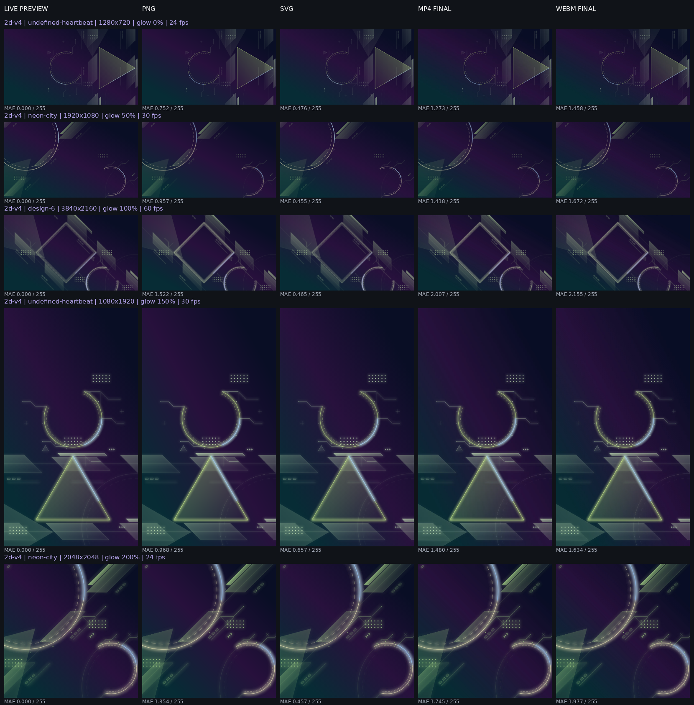
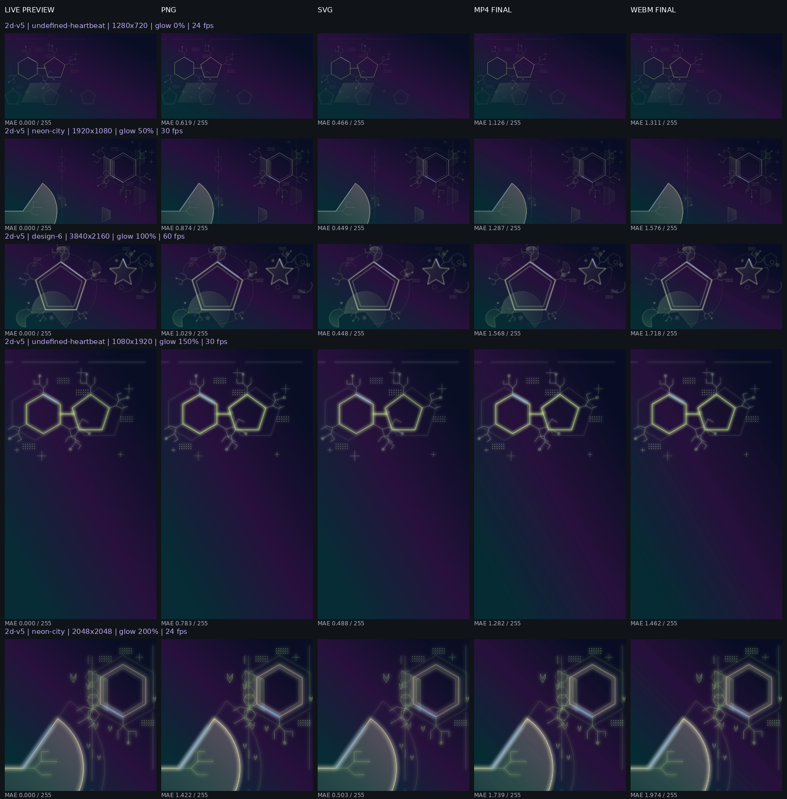

# プレビュー・静止画・動画の共通描画品質

## 原因

共通の `Preview.tsx` で、主役・アクセントはSVGのviewBox座標で線幅を扱う一方、補助・装飾のpath/circleだけに `vector-effect="non-scaling-stroke"` が付いていた。この属性は出力先のピクセル数に線幅を固定するため、高解像度にしても線だけが太くならず、同じ表示サイズへ縮小したときに細く見える。

公開mainの実測例：viewBox 1600×900、CSS幅742.39px、DPR 1。neon-cityの補助線はstroke-width 1.08に対してnon-scaling-strokeがあり、表示倍率にかかわらず1.08 CSSpxだった。3840pxで出力して同じ幅へ縮小すると、固定線幅だけが約0.21px相当まで細くなる。主役の線は既にSVG座標で拡縮していた。

## 修正

- pathとcircleからピクセル固定指定を削除。生成器が短辺基準で決めたstrokeWidthをそのままSVG座標として使用する。線幅を一律に増やす変更はしていない。
- プレビュー・完成SVG・PNG・動画フレームはすべて既存のPreviewを使うため、同じ修正が全出力へ適用される。小さなプレビューで補助線だけが相対的に太くなる挙動も解消される。
- v4/v5生成器、シード、座標・サイズ・回転、密度候補、配色、塗り不透明度、成長スケジュールは変更しない。アルゴリズム版も維持する。
- 2048×2048・24fpsでビットレートが20,132,659.2になり、整数を要求するエンコーダーに拒否される既存不具合も、整数へ丸めて修正した。

## 調査した他の要因

- viewBox：現在の構図座標を維持。解像度変更時はpreserveAspectRatioに従い、比率が異なる場合は背景色の余白を付ける。図形を引き伸ばさない。
- CSS：artworkは表示幅・高さだけを指定し、線幅・透明度・色を上書きしていない。独立SVGではこのアプリ用クラスを除去する。
- Canvas：指定出力ピクセル数でCanvasを作り、同寸のSVGを描画する。プレビュー画面を拡大キャプチャする処理ではない。
- 動画：同じPreviewを時刻指定でレンダリングし、完成フレームは静止画と同じ描画状態を使う。再生速度・イージング・進行率処理は維持。
- 発光：ぼかし半径、フィルター領域、透明度は既に図形座標で定義されており、今回変更していない。線も同じ座標に統一することで、線と発光の相対比を維持する。
- DPR：画像・動画の出力寸法は指定ピクセル数そのもの。devicePixelRatioを掛けて出力寸法や線幅を変更しない。

## 比較方法

`tests/render-quality.spec.ts` では、undefined-heartbeat / neon-city / design-6、v4 / v5で、以下の5解像度を実際にPNG・SVG・MP4・WebMへ保存する。動画は1秒・4倍速、末尾フレームをFFmpegで番号指定抽出する。

| 出力解像度 | 比率 | 発光 | FPS |
| --- | --- | --- | --- |
| 1280×720 | 16:9 | 0% | 24 |
| 1920×1080 | 16:9 | 50% | 30 |
| 3840×2160 | 16:9 | 100% | 60 |
| 1080×1920 | 9:16 | 150% | 30 |
| 2048×2048 | 1:1 | 200% | 24 |

ライブプレビューの実スクリーンショットと、ダウンロードした4形式を同じ幅320 CSSpxへ揃えて比較する。PNGと動画の縮小には高品質リサンプリングを使用する。SVGはブラウザでベクターとして再描画する。出力SVGの図形ID・種類・変換行列・線幅がプレビューと一致することも検証する。

別の線幅テストでは、主役・補助・装飾の同じ線を640 CSSpxで表示し、1280・1920・3840出力とDPR 1/2を比較する。4 SVG単位の線は640/1600倍で理論1.6 CSSpx相当となり、全役割が同じ画素量になることを確認する。

## 比較画像

各行の左から、Preview / PNG / SVG / MP4最終フレーム / WebM最終フレーム。同じ行は同じシード・設定・表示サイズ。縦長画像も各列で同じ倍率に揃えている。

## 制限

ベクターを小さいサイズへ直接描画するSVGと、大きい画像を縮小するPNGではアンチエイリアス・リサンプリングによる微小差が残る。動画は非可逆圧縮と色差サブサンプリングにより、小さい色付き線や発光に軽微な差が残る。異なるブラウザ・GPU・DPRで画素単位の完全一致は保証しない。

高解像度・高発光は処理負荷が高い。動画対応コーデックはブラウザに依存する。実機iPhone Safariでのエンコード検証は未実施で、モバイル表示・操作はChromiumで検証する。

実行：`npm run typecheck`、`npm test`、`npm run build`、`CHROMIUM_PATH=/usr/bin/chromium npx playwright test`。動画比較テストにはFFmpeg / FFprobeが必要。

## 検証結果（Chromium）

- 上表の5解像度 × v4/v5で、PNG・SVG・MP4/H.264・WebMをすべて実出力。検証環境で出力できない解像度はなかった。
- 3シードで大型多角形・枠・部分円弧・回路状ラインを含む比較画像を目視確認。配置の変化や明確な線幅の縮小、発光の消失は見られなかった。
- ライブプレビューに対する平均RGB絶対誤差（0〜255）は、PNG最大1.522、SVG最大0.657、MP4最大2.007、WebM最大2.155。数値は全画像の平均であり、局所的な画素差の上限ではない。詳細はmeasurements.jsonを参照。
- 線幅の実測：1600単位のキャンバスを640pxで見ると、従来は補助線が640出力で4px相当、3840出力の縮小で約0.745px相当へ減少。修正後は主役・補助・装飾の全役割が、640出力で約1.506、3840出力の縮小で約1.686の画素量となり、解像度に依存した線幅の崩れを解消。端数の差はラスタライズ・縮小処理による。DPR 1/2でも回帰テスト成功。
- 型チェック・ユニット122件・ビルド成功。既存の開始/途中/完成、完成直前の塗り・部分円弧、5イージング、密度・配色固定、PNG/SVG/JSON、動画24/30/60fps、スマホ操作の回帰も検証対象とした。
- ブラウザ検証は大規模比較1件＋その他24件の合計25件すべて成功。
