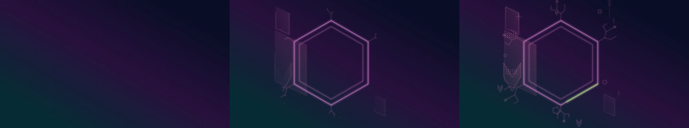

# 第4段階：2D成長アニメーション動画

## 使用方法

1. `npm ci` → `npm run dev`。PCの最新Chrome / EdgeなどWebCodecs対応ブラウザで開く。
2. シード・構図・配色・密度・発光と、成長時間・再生速度・イージングを設定する。
3. 「保存・再利用」内の「動画書き出し」を開く。
4. WebM / MP4、解像度プリセットまたはカスタム幅高さ、24 / 30 / 60fpsを選び、「動画を書き出す」を押す。
5. 進捗が100%になったらダウンロードが開始される。処理中はキャンセル可能。

開始時の設定を複製するため、処理中にプレビューを編集しても出力内容は変わらない。プレビューの一時停止・シーク位置にも依存しない。動画解像度の変更では構図の縦横比を変更せず、必要に応じて背景色の余白を付ける。

設定JSONには `exportVideoFormat` / `exportVideoWidth` / `exportVideoHeight` / `exportVideoFps` を保存する。旧JSONではWebM・1280×720・30fpsを使用する。PNG / SVGは従来どおり完成状態を書き出す。

## フレームと再現性

`video-frame.tsx` は既存Preview・スケジュール・イージングを使用し、任意の時刻からSVGを生成する。Canvasへラスタライズした各フレームをWebCodecsへ渡し、MediabunnyでWebMまたはMP4へ格納する。画面録画、MediaRecorder、captureStreamは使用しない。

フレームiの時刻は `min(i / fps, 成長時間 / 再生速度)`。背景のみの先頭と、完成した末尾を必ず含める。最終フレームを1フレーム分保持するため、動画長は `（ceil(成長時間 / 再生速度 × fps) + 1） / fps` 秒。アニメーションOFF時は先頭のみ背景、その後は完成状態を保持する。

配置・成長順序・フレーム時刻は決定的で、生成中の乱数や実時間の進みには依存しない。コンテナ作成時刻も除外する。ただし動画は非可逆圧縮であり、ブラウザ・OS・エンコーダーの違いによるバイナリや微小な画素差まで保証するものではない。

## 対応と制限

- WebMはVP9優先、VP8へ対応判定でフォールバック。MP4はH.264のWebCodecsエンコーダーがある場合のみ。形式・解像度ごとに実行環境で判定し、非対応なら開始ボタンを無効にして案内する。
- ブラウザやOSの提供するコーデックに依存するため、Safariを含む全端末で両形式を保証することはできない。非対応時はPCの最新Chrome / Edgeなどを利用する。バックエンド・CDN・外部変換サービスは不要。
- 動画は幅高さ256〜4096pxの偶数、合計8,388,608画素以下、出力256MB以下。高解像度・60fps・長い成長時間はメモリと処理時間を要する。高解像度はPC推奨。
- 音声なし。動画はエンコードのため静止画SVGより微小な色差がある。
- 動画関連ライブラリは動画設定を開いた時点で遅延読込する。

## 検証

`npm run typecheck` / `npm test` / `npm run build`。

`CHROMIUM_PATH=/usr/bin/chromium npx playwright test tests/video.spec.ts` はFFmpeg / FFprobeを必要とする。実動画の再生・フレーム数・開始/終了フレームとSVGの比較・再生成した全フレームのハッシュ一致・FPS/比率/発光・JSON復元・キャンセル・非対応表示を確認する。ブラウザのMP4エンコーダーが使用可能なら実際のMP4も出力してH.264を検証する。

## 実測結果（開発環境Chromium）

- 型チェック・ビルド成功。ユニット120件、ブラウザ23件成功。
- WebM：24fps/16:9/発光0%、30fps/9:16/発光100%、60fps/1:1/発光200%を実出力し、FFprobeで寸法・フレーム数を確認。HTML video要素で再生成功。
- 先頭背景と末尾完成画像をSVGと比較し、RGBの平均絶対誤差はテスト許容値8/255以内（非可逆圧縮を考慮）。同じ設定で2回生成したWebMは、FFmpegで復号した全フレームのハッシュ一致。
- MP4：検証環境でH.264出力成功。非対応WebCodecs環境では案内表示・開始禁止を確認。
- 1920×1080・30fps・2秒・発光100%の代表WebM：61フレーム、2.033秒、約1.18MB。開始・1秒・完成フレームを実際に確認。
- 既存のPNG/SVG/JSON、カラー固定、密度、成長、スマホ幅の操作・表示の回帰テスト成功。直近の塗り・部分点線円のブラウザテスト、連結・枝重複・放射装飾の生成テストも成功。
- 実機iPhone Safariでの動画エンコード確認は未実施。スマホ幅のChromiumによる表示・操作検証を実施。

