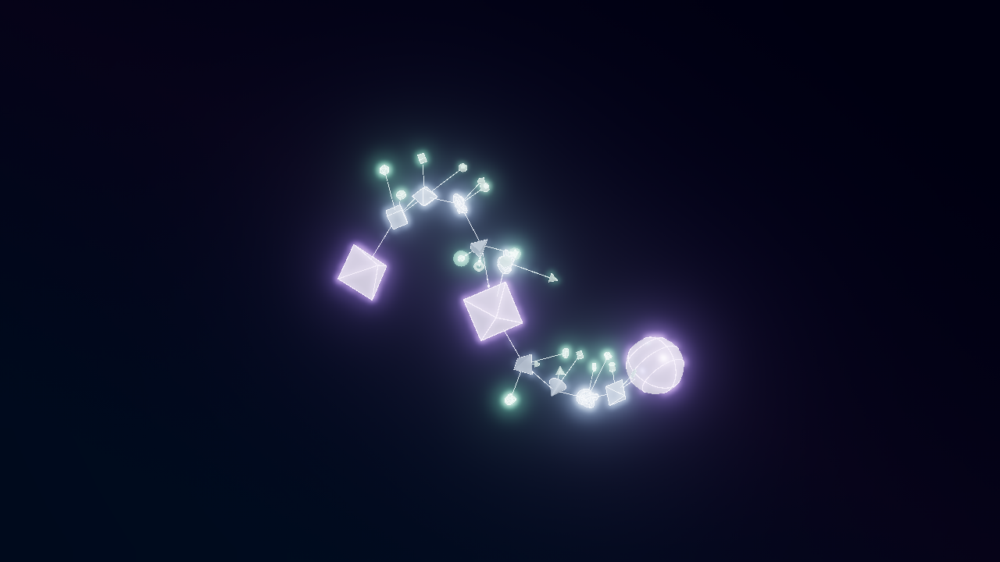
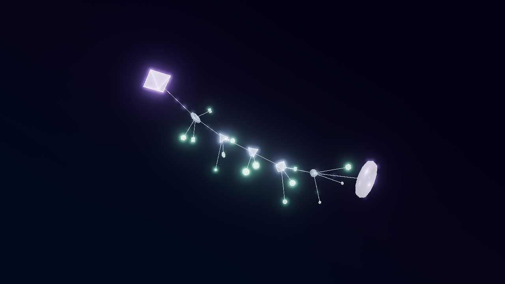
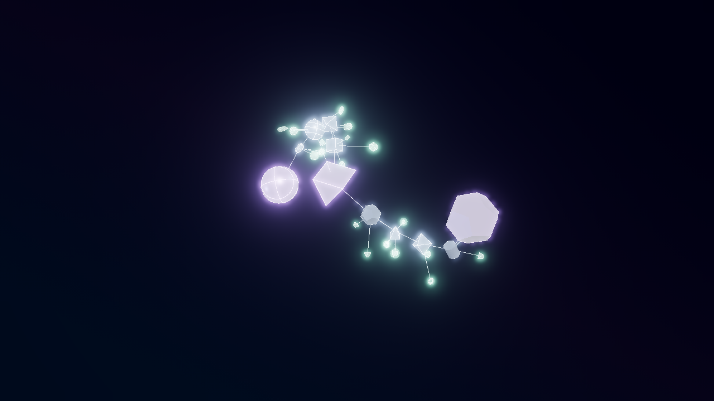
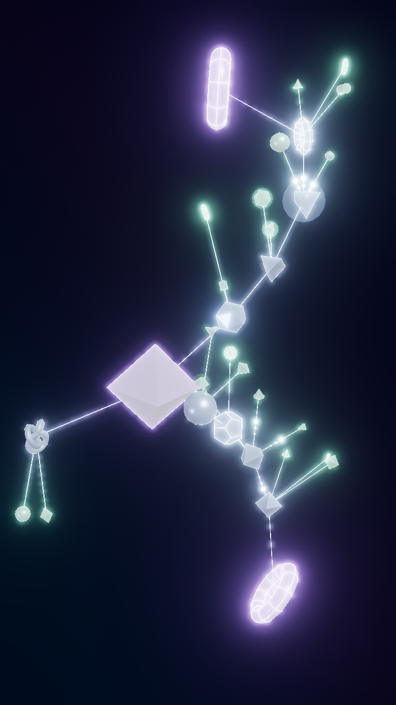

# VOID MODE 第1段階

この資料と同梱JSONは `void-filaments-v1` の記録です。大規模版を含むアプリで旧版を生成する場合は「背景 → VOIDの構造 → 小規模プロトタイプ」を選択してください。新規VOIDの大規模版については [void-web-v2](../void-web-v2/README.md) を参照してください。保存済みv1 JSONは旧構図のまま読み込めます。

基準は PR #109 の `main`（`d18264d`、PR #89 と同一ツリー）です。削除された VOID 実装は使用せず、新しい `void-filaments-v1` として生成器・描画器を追加しました。今回の範囲は最大35図形の構造確認です。mainへのマージとPages公開は行いません。

## 操作

1. `npm ci` → `npm run dev` で起動し、「3Dモード」に切り替えます。
2. 「背景」→「VOID MODE」をONにします。新規設定の初期値はOFFです。
3. 「装飾」で配線のグラデーション・発光・電気信号・輪郭を調整できます。VOID専用の配線・輪郭設定は通常3Dと分けて保存します。
4. ドラッグ／タッチで回転、ホイール／ピンチでズームします。再生・登場演出・待機切り替え・PNG・動画・3D設定JSONは既存の操作を使います。
5. VOIDをOFFに戻すと通常の生成器と描画器に戻ります。シードを変更していなければ、切り替え前の通常3Dのカメラ・再生時刻・待機完了状態を復元します。

## 構造

`void-graph.ts` は先に結び目と空洞の制約領域を決め、空洞を避ける曲がったフィラメントのグラフを生成します。空洞は不可視の配置制約であり、球や粒子として描画しません。

- 主要な結び目は2〜3個、主要フィラメントは1〜2本です。
- フィラメントは3D曲線を等距離に近い間隔で分割し、実際の中継図形を5〜9個配置します。ワイヤーはその中継点を順番につなぎます。結び目3個の場合は中央に小さな脇の経路を加え、実際の3方向の結節を作ります。
- 中継点の近傍に短い枝を2〜3本ずつ作り、小図形を10〜23個配置します。方向には経路に沿った相関と変化を持たせ、空洞や既存図形との近接を検査します。
- 全配線を線分単位で空洞との最短距離により検査します。ノードだけ安全で、途中の直線が空洞を横断する配線は採用しません。最近傍での配線の張り直しは行いません。
- `rootId` は中継図形が主要フィラメントを経由して所属する結び目、`parentId` は小図形を直接支える中継図形です。すべての中継を結び目へ直結する放射構造にはしません。フィラメントの経路と枝の明示的なエッジが実際の接続関係です。
- 密度は既存候補の表示だけを変更し、座標や種類を動かしません。0%ではすべて非表示。5%以上では骨格を維持し、枝を段階的に追加します。

`VoidObjects.tsx` は既存13種類の実体図形を最大13個のInstancedMeshにまとめます。輪郭は最大3個のバッチで描画します。インスタンスごとの透明度・発光を属性として扱い、図形ごとのReactコンポーネントは作りません。通常の `Solid` と通常の生成器は変更していません。

ワイヤー・グラデーション・電気信号・残光・到着エフェクトは既存 `NetworkLines` / `NeuralSignals` を使用します。登場、待機モーフ、出現消失、カメラ、時刻指定動画の処理も既存エンジンを使用します。VOIDの登場は配置を崩さない `neural-grow`、浮遊は通常設定の18%の量を使用します。通常3Dの保存値は書き換えません。

設定は既存の3D JSON内にオプションの `settings.voidMode` として保存します。新しいアルゴリズム版はこの内部に保持します。旧3D JSONにこのキーがなければOFFとして従来どおり復元し、通常3Dの `3d-v1` や2Dの設定形式は変更しません。不明なVOID版はエラーにします。

## 実際の描画

全画像は実ブラウザのWebGL描画を既存PNG書き出し機能で保存したものです。各画像と同名のJSONを「書き出し」から読み込んで視点・色・時刻を復元できます。

| シード | 比率／視点 | 図形／配線 |
|---|---|---|
| cosmic-web-01 | 16:9、正面寄り | 33 / 32 |
| filament-prototype-01 | 16:9、正面寄り | 21 / 20 |
| cosmic-depth-17 | 16:9、斜めから奥行きを確認 | 34 / 33 |
| cosmic-web-01 | 9:16 | 34 / 33 |






確認した画像では、1点から全方向に広がる放射配置や巨大な閉多角形は見られませんでした。空洞を避ける曲がった骨格と局所的な枝が見えます。ただし小規模のため、1本のフィラメントのシードは枝の付いた鎖として見えます。多数の空洞を囲む大規模な宇宙の網目の完成版ではありません。

再撮影：開発サーバー起動中に `node scripts/capture-void-prototype.mjs`（必要なら `CHROMIUM_PATH` を指定）。

## 検証

ローカル結果：TypeScript型チェック、本番ビルド、Vitest **50ファイル・364件**、既存3DのPlaywright **27件**、VOID専用Playwright **5件**が成功しました。VOIDでは256×256・24fps・1秒のMP4／WebM書き出しも成功しました。確認に使ったブラウザはChromiumです。本番ビルドには既存の大きなチャンクに関するVite警告があり、3D描画器は引き続き遅延読み込みです。

当初のGitHubチェックで失敗していた既存2Dテスト2件は、未変更main (`d18264d`) でも再現する、ヘルプ開閉UIとテスト操作の不一致でした。続きの作業で、`grid-background.spec.ts` と `text-entrance.spec.ts` の該当操作を「ヘルプを開く → ポップオーバーの説明を確認 → Escapeで閉じる」に修正しました。生成・描画・動画などの製品コードは変更せず、説明文と後続の設定・書き出しの検証を維持しています。関連2Dブラウザテスト5件、VOID関連ユニットテスト5件、型チェック・ビルドの成功を再確認しました。比較用サーバーはReact／Viteキャッシュの混在を防ぐため依存ディレクトリを分離しています。最新のGitHubチェック結果はPR #110を参照してください。

- Vitest：決定性、30シードの差異と13種類の使用、24シード×全8比率で図形数・親子・接続・空洞回避・局所密集・奥行き・浮遊時の空洞余裕、密度による座標維持、旧設定互換、JSON往復、不正値拒否。
- Playwright：未変更mainを別サーバーで起動し、VOID OFFのPNGが画素単位で一致することを比較。ON/OFFで通常3Dのカメラ・時刻・配線設定を維持することも検査。
- 実際のInstancedMesh数、密度0→100復帰、JSON復元後のPNG一致、別シードの差異、既存の時刻指定動画出力を検査。
- タッチ対応の390×844画面で軽量描画、電気信号、PNG、待機モーフ切り替え、横はみ出しなしを検査。実機のiPhone／Androidでの検証ではありません。
- 既存通常3Dの配線、登場演出、待機モード、動画、カメラ、PNG、2Dへの復帰のブラウザ回帰テストを実行。

ローカルで変更前と比較する場合は、別の未変更mainの開発サーバーを5180番で起動し、次を実行します。

```sh
VOID_REFERENCE_URL=http://127.0.0.1:5180 npx playwright test tests/void-prototype.spec.ts
```

## 第1段階の制限

- 図形は最大35個です。数百〜2,800個への拡張、無限空間、複数フィラメントの閉ループや面状構造の生成は未実装です。明示的なグラフ形式を将来の相互接続追加に使えます。
- 配線自体の描画・信号エフェクトは既存処理を維持しています。経路ごとの太さの個別指定や大規模GPUグラフ描画は追加していません。
- VOIDでは通常の図形間隔スライダーと、図形を天体へ置き換える設定を適用しません。既存13種類の図形を使用し、通常モードの設定値は維持します。
- 半透明の図形面には既存の3D表示と同様に描画順の限界があります。大規模化前に追加の性能・描画品質評価が必要です。長時間の実機スマートフォン試験は行っていません。
