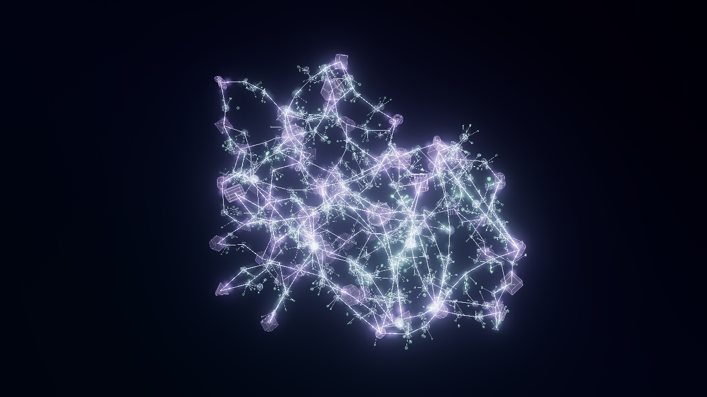
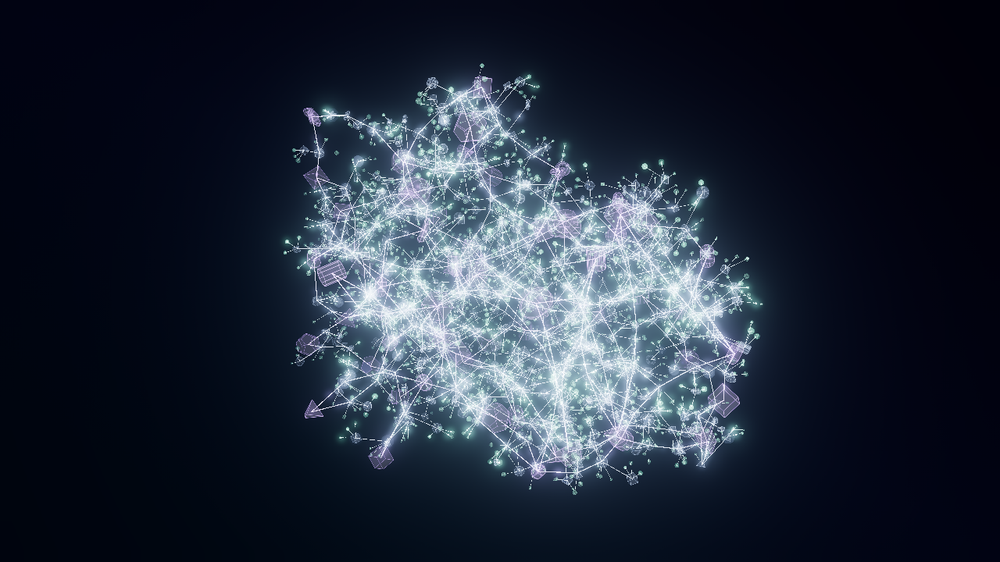
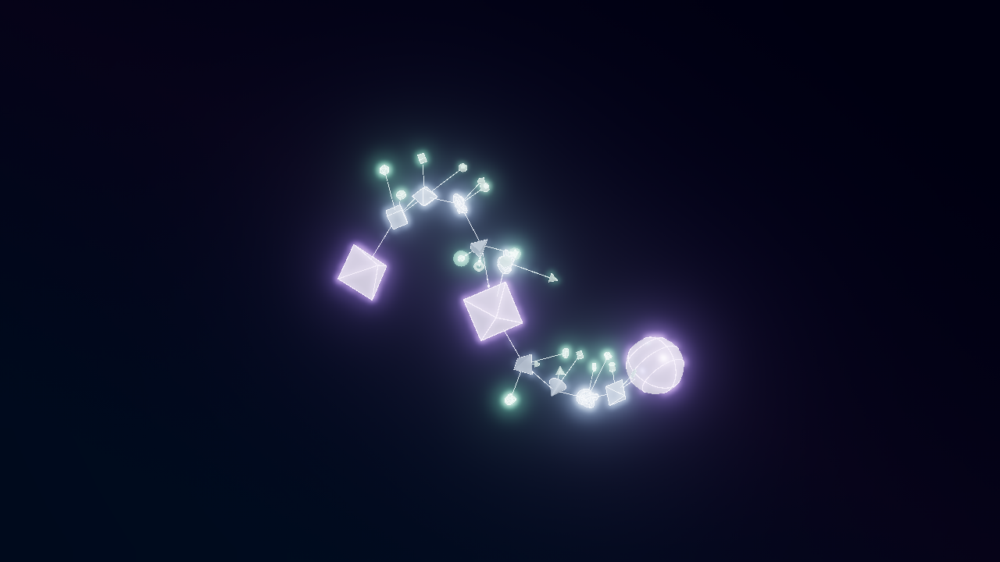

# 大規模 VOID MODE — void-web-v2

第1段階の `void-filaments-v1` を残して、大規模なコズミックウェブ用の独立した生成器を追加しました。通常3Dの生成器、2D生成器は変更していません。開発ブランチは `feat/void-cosmic-web-v2`、基準は第1段階の `e2943b9` です。第1段階が未マージのため、そのブランチをベースとする確認用PRです。自動マージ・本番公開は行いません。

## 使い方

1. `npm ci` → `npm run dev` で起動します。
2. 「3Dモード」→「背景」→「VOID MODE」をONにします。新規VOIDは大規模版を選びます。通常モードの初期状態は引き続きOFFです。
3. 「VOID描画上限」は600〜2,800、標準1,400。「図形」の密度と併用します。0%は図形なし、5%以上では骨格を残し、密度を上げるほど支流と小図形が増えます。上限に達すると追加しません。
4. 「奥行きの減衰」は0〜100%、標準80%。奥の線や図形を控えめにして空洞を見やすくします。背景色・図形色の保存値は変えません。
5. 「装飾」の配線・輪郭・発光・電気信号、既存の回転・浮遊・登場・待機切り替え、ドラッグとピンチによる視点操作を利用できます。
6. 「書き出し」でPNG、MP4/WebM、設定JSONを保存します。3D PNGは現在の視点・時刻の状態です。完成まで動画に含める場合は、登場時間以上の動画の長さを指定してください。
7. 旧版を再現する場合は「VOIDの構造」→「小規模プロトタイプ」を選択するか、保存済みv1 JSONを読み込みます。旧JSONを大規模版に自動変換しません。

## 生成の仕組み

### 空洞からグラフを先に作る

36個の不規則な空洞サイトと、外周を閉じるための20個の制約サイトをシードから生成します。これらは配置制約であり、背景の球や粒子として描画しません。

3D Delaunay複体の双対を使い、複数の空洞が接する位置を結節、隣接する結節の間をフィラメント候補にします。平面の格子や、ランダムな図形を後から最近傍で結ぶ方法は使いません。近すぎる結節を空洞との距離を検査しながらまとめ、主要結節の次数は最大6に制限します。最大の連結成分を採用するため、独立した小さな島を散布しません。

主要フィラメントには曲がった経路と中継図形を置きます。描画する線分は、その実在する中継図形の中心を順に結びます。すべての線分について、端点だけでなく内部まで空洞との距離を検査します。曲線のふくらみが空洞に入る場合は曲率を抑え、安全な経路にします。

フィラメントに沿って細い支流を追加し、その中継から少数の小図形を伸ばします。小図形の直接の親は中くらいの図形です。主役から全方向へ大量の枝を伸ばさず、主要経路に沿って構造を分散します。主要フィラメント、支流、小枝で線幅にも差を付けます。

グラフには複数の環状経路があります。代表シードでは約60〜70結節、120本前後の主要フィラメントを持ちます。これは巨大な1個の多角形の輪郭ではなく、奥行きのある複数の空洞を囲むネットワークです。

### 再現性・密度・保存

- 図形候補は最大2,800個。各候補に固定ID、役割、所属フィラメント、結節、親ID、表示開始密度を持たせます。
- 密度・描画上限・画質は表示候補を選ぶだけです。共通する候補の位置・サイズ・回転・成長時刻は動かしません。親を非表示にした場合は、その装飾も表示しません。
- 同じシード・比率・生成版なら同じグラフを生成します。フレームごとの乱数や生成順への依存はありません。
- 設定は既存3D JSON内の `settings.voidMode` に保存します。`version: "void-web-v2"`、`objectLimit`、`depthFade` を追加し、不正な版・数値を検証します。旧 `void-filaments-v1` の設定は旧生成器へ渡します。
- 自動画質は端末により描画上限が変わります。端末間でも同じ描画数と曲面精度に揃える場合は、画質・上限・視点・解像度を明示的に揃えてください。候補の配置自体は画質に依存しません。

## 描画と負荷対策

実体は既存13種類の立体です。本体13バッチ、輪郭13バッチのGPUインスタンシングにまとめ、図形ごとのReactコンポーネントは作りません。輪郭はテンプレートの線分をGPUで各図形の位置へ変換し、毎フレーム全輪郭頂点をCPUから送る方式を避けています。

広い視点では曲面の分割数を抑え、近づくと高い精度へ切り替えます。精度は保存したカメラ位置から決定し、過去の視点操作に依存しません。軽量品質は最大640図形・さらに少ない分割数・ブルーム省略です。自動画質ではスマホとソフトウェアWebGLを軽量化します。図形の種類や配置は維持します。

既存の `NetworkLines` / `NeuralSignals` を再利用し、ワイヤーのグラデーション、発光、電気信号、残光、到着エフェクトを維持します。通常3Dでは既存の処理を使い、VOIDだけに高速な伝播計画と線幅を渡します。伝播は実際のグラフ上で複数の主要結節から開始します。これは配線の再生成ではありません。

待機モーフもVOID専用の空間順マッチングを使用します。2,800×2,800の全ペアを作る方式を避け、グラフと描画バッファは必要な構図だけを保持します。使わなくなったGeometryとMaterialは破棄します。奥行きの減衰も、待機中の背景色・構図の変化に合わせて補間します。

時刻指定の描画を既存の3D動画エンジンへ渡します。大規模版は停止中でも時刻0を背景のみとして扱い、動画の先頭に完成した図形が混入しないようにしています。通常3Dと旧VOIDの停止時の挙動は維持します。

## 確認画像

実ブラウザのWebGLを既存PNG機能で保存した画像です。同名JSONを読み込んで構図・配色・視点を復元できます。スマホ幅のJSONは、端末を変えても640図形を保つため、撮影時に自動判定された軽量品質を明示して保存しています。条件と描画数の一覧は [gallery.json](gallery.json) を参照してください。

| 条件 | 描画数 | 画像・設定 |
|---|---:|---|
| 標準：16:9・密度50%・上限1,400 | 1,400 | [PNG](standard.png) / [JSON](standard.json) |
| cosmic-web-01：16:9・最大 | 2,800 | [PNG](cosmic-web-01.png) / [JSON](cosmic-web-01.json) |
| cosmic-web-02：16:9・最大 | 2,800 | [PNG](cosmic-web-02.png) / [JSON](cosmic-web-02.json) |
| cosmic-depth-17：16:9・最大 | 2,800 | [PNG](cosmic-depth-17.png) / [JSON](cosmic-depth-17.json) |
| 正方形：1:1・上限1,400 | 1,400 | [PNG](square.png) / [JSON](square.json) |
| スマホ幅：9:16・自動画質 | 640 | [PNG](portrait-lightweight.png) / [JSON](portrait-lightweight.json) |

### 標準構図



### 最大構図



### 第1段階との違い

第1段階は1〜2本のフィラメントと2〜3個の結び目でした。今回は複数の空洞を囲み、フィラメント同士を結節でつなぎ、環状経路も持たせています。旧版は下の画像と同梱v1 JSONで引き続き再現できます。



最大密度では線と装飾が多くなり、視点によって前後の構造が重なります。標準設定と奥行きの減衰、回転やズームで空洞とフィラメントを確認できます。

## 検証

- 型チェック・本番ビルド、全51ファイル・387ユニットテストが成功。
- ユニットテスト：シード別の決定性、13種類の使用、3シード×3比率の空洞回避・連結性・次数・環状経路・親子関係・3Dの広がり、密度／上限／軽量設定の位置保持、浮遊時の空洞余裕、Delaunay複体の空球条件、信号計画、待機マッチング、JSON・旧版互換、時刻0と完成時の姿勢。
- Chromium：新規4ケースが成功。新規VOIDと旧版の切り替え、2,800図形の実際のGPUバッチ、JSON後のPNG一致、密度と上限の復帰、奥行きの減衰、ズームによる精度切り替えと近距離視点のJSON復元、640図形でのスマホ幅の成長・タッチ操作・待機切り替え。
- Linux WebKit：スマホ幅の成長・タッチ操作・一時停止・待機切り替えの1ケースが成功。実機iPhone Safariでの確認ではありません。
- MP4／WebM：600図形・256×256・24fps・3秒。先頭を背景PNGと比較し、最終フレームを同時刻PNGと比較（圧縮差は許容）。出力後にプレビューが元の状態へ戻ることも確認。
- 通常3Dと保存済みv1 VOIDのPNGが、拡張前の第1段階のサーバーと画素単位で一致することを確認。
- 既存の通常3D・配線・登場・待機・カメラ・床・13図形・PNG・2Dへの復帰のブラウザ回帰30ケースが成功。

最新の自動チェック結果は確認用PRのChecksを参照してください。

再撮影・短時間の負荷測定：

```sh
CHROMIUM_PATH=/usr/bin/chromium node scripts/capture-void-web.mjs
CHROMIUM_PATH=/usr/bin/chromium node scripts/profile-void-web.mjs
```

## 制約と測定の範囲

- 最大2,800図形はGPUのあるPC向けです。クラウドで使ったSwiftShaderはCPUによるソフトウェアWebGLで、短い観測では軽量設定でも約2fps、最大設定では約1fps未満でした。実機PCやスマートフォンのFPSを示す結果ではありません。生の測定値は [performance.json](performance.json) に保存しています。
- ソフトウェア描画で最大規模を滑らかに再生できる状態には達していません。画質の自動軽量化、上限、分割数の削減は実装しています。物理GPU・実機iPhone/Androidでの長時間確認は未実施です。
- 今回は有限な3D領域の網目生成です。無限ワールド、追加の3D図形、物理的な宇宙進化シミュレーションなどは追加していません。
- 高解像度・長時間の動画は端末のWebGL／WebCodecs／メモリ制限を受けます。既存の解像度・容量・時間制限、キャンセル操作を維持しています。
- 遠景の描画精度切り替えは曲面の分割数に作用します。位置・半径・回転・接続を動かしません。半透明面には通常の3D表示と同様、描画順による限界があります。
